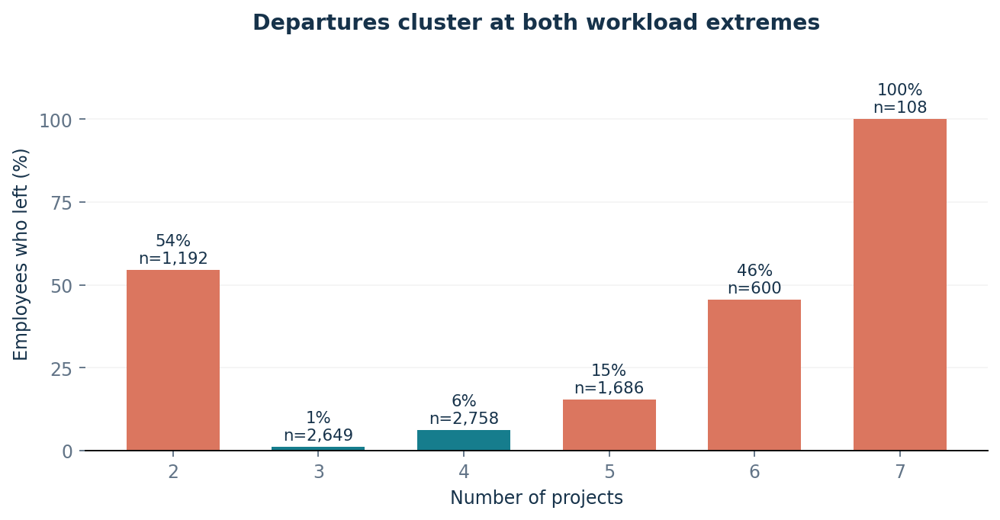
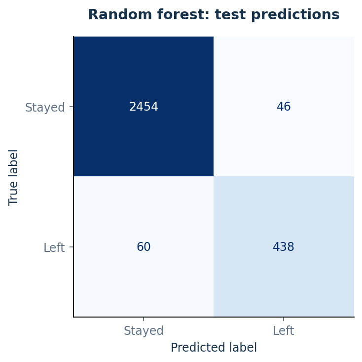
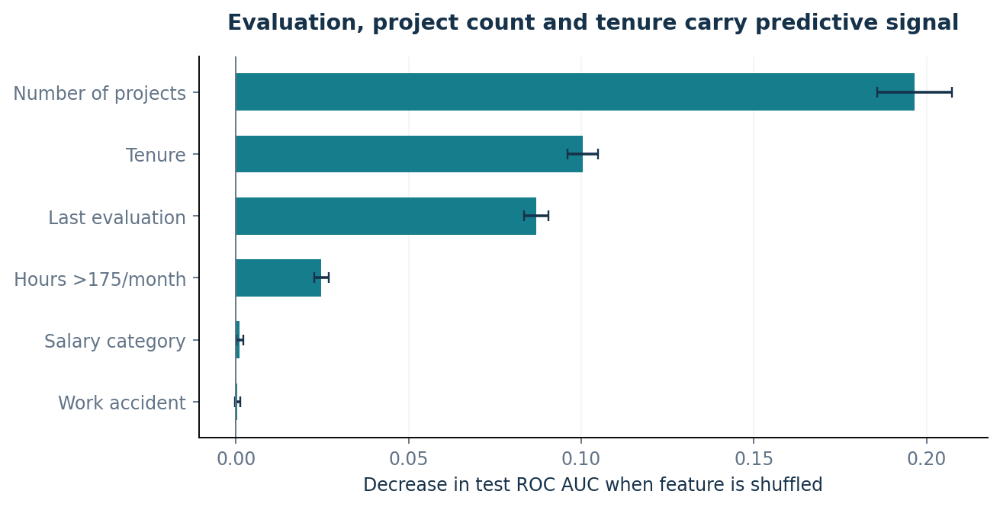

# Employee Attrition at Salifort Motors: Decision Trees and Random Forests

**Sebastián Madrigal López** · Google Advanced Data Analytics capstone project

## Project Overview

This project examines employee departures in the Salifort Motors case study and develops
a classifier to support retention research. The analysis combines data preparation,
exploratory analysis, feature engineering and a comparison of decision trees and random forests.

The selected reduced-input random forest achieved **ROC AUC 0.968, precision
90.5%, recall 88.0% and F1 0.892** on 2,998 test records.
It detected **438 of 498 recorded departures**, with **46 false positives**.

[Executive summary (PDF)](reports/executive_summary.pdf) ·
[Executive summary (text)](reports/executive_summary.md) ·
[Data exploration](notebooks/01_data_exploration.ipynb) ·
[Modeling and evaluation](notebooks/02_modeling_and_evaluation.ipynb)

## Business Understanding

The HR team seeks to understand patterns associated with employee departures and identify
priorities for retention research. The analysis focuses on workload, tenure, satisfaction
and evaluations. The target, `left`, identifies recorded departures.

The project follows the **PACE framework**: Plan, Analyze, Construct and Execute.
Its outputs are an evaluated classifier and evidence-based questions for HR about project
allocation, career development and employee experience.

## Data Understanding

The supplied CSV contains **14,999 rows and 10 columns**, with complete values.
Removing **3,008 exact repeated rows** produces an analysis population
of **11,991 records**, including **1,991 departures
(16.6%)**. The source departure rate is 23.8%.

Deduplication treats repeated records as redundant observations. This is an analytical
assumption because employee identifiers are unavailable. Salary is measured in three ordered
categories: low, medium and high. The [data dictionary](data/README.md) documents the variables,
processing decisions and source limitations.

Detailed exploration uses training rows. Departure rates are elevated at both extremes
of project count, with different patterns across monthly hours and satisfaction levels.



The dataset reference is
[HR Analytics and Job Prediction](https://www.kaggle.com/datasets/mfaisalqureshi/hr-analytics-and-job-prediction).
Salifort Motors provides the educational business scenario.

## Modeling and Evaluation

1. Remove exact repeats and create a **75/25 stratified split**, `random_state=0`:
   8,993 training rows and 2,998 test rows.
2. Define two feature scenarios. **Full inputs** use all nine predictors. **Reduced inputs**
   remove satisfaction and replace exact monthly hours with `overworked = hours > 175`.
3. Fit salary and department encoders within each CV training fold using pipelines.
4. Compare decision trees and random forests using **four-fold shuffled stratified CV**.
   Select hyperparameters and the primary reduced-input model by mean CV ROC AUC.
5. Evaluate the fixed candidates on the test partition alongside a majority-class baseline.
   Classification uses the default **0.5 threshold**.

The reduced scenario assesses reliance on satisfaction and exact hours. Each scenario
evaluates 12 tree configurations and 8 forest configurations, with 200 trees per forest.

### Test results

| Inputs | Model | ROC AUC | Avg. precision | Precision | Recall | F1 | Accuracy |
|---|---|---:|---:|---:|---:|---:|---:|
| Baseline | Majority baseline | 0.500 | 0.166 | 0.000 | 0.000 | 0.000 | 0.834 |
| Full | Decision tree | 0.970 | 0.942 | 0.972 | 0.906 | 0.938 | 0.980 |
| Full | Random forest | 0.984 | 0.962 | 0.962 | 0.920 | 0.940 | 0.981 |
| Reduced | Decision tree | 0.952 | 0.853 | 0.784 | 0.918 | 0.846 | 0.944 |
| Reduced | Random forest **(selected)** | 0.968 | 0.904 | 0.905 | 0.880 | 0.892 | 0.965 |

The positive class is `left=1`. ROC AUC and average precision use predicted probabilities;
precision, recall, F1 and accuracy use class predictions. The baseline predicts the majority
class and assigns the training departure rate as a constant probability.

The selected forest achieved **CV ROC AUC 0.967**. On the test partition,
it missed **60 departures** and produced **46 false positives**. The full-input forest
achieved the highest test ROC AUC, indicating additional predictive information in satisfaction
and exact hours. Complete results and search parameters are available in [reports/tables](reports/tables/).



### Interpretation

Permutation importance identifies project count, tenure, last evaluation and the workload
indicator as the selected model's leading inputs. Importance is calculated on test rows
after selection and measures the decrease in ROC AUC when an input column is shuffled.
Error bars show standard deviations across five repeats. Correlated features can share
predictive information, affecting their individual importance estimates.



### Limitations

- Collection dates, predictor timing, exit type and employee identifiers remain undocumented.
- Exact-repeat removal and the 175-hour workload cutoff are analytical assumptions.
- Structured clusters and limited provenance constrain interpretation across workforces.
- Operational use requires probability calibration, an intervention cost model and validation
  of predictor availability at the intended prediction time.

## Conclusion

The reduced-input random forest classifies recorded departures with strong internal performance.
Workload, tenure and evaluation patterns provide priorities for retention research.

Recommended next steps:

- Review project allocation at both workload extremes.
- Investigate career progression and support around tenure groups with elevated departure rates.
- Examine how evaluation practices relate to workload and employee experience.
- Confirm predictor timing and exit type, then validate on a later cohort.
- Pilot a defined support intervention and measure its effect on retention and employee outcomes.

The findings describe predictive associations. Estimating the effects of interventions requires
prospective evaluation.

## Reproduce the Analysis

Tested with **Python 3.12.14** and the packages pinned in `requirements.txt`.
From the repository root:

```bash
python -m venv .venv
source .venv/bin/activate
python -m pip install -r requirements.txt
python scripts/execute_notebooks.py
python scripts/build_reports.py
```

On Windows, use the activation script in the `.venv/Scripts` folder.
The notebook runner executes all cells in a fresh namespace for each notebook and saves their
outputs. It supports the plain Python cells used in this project.

For interactive work, install JupyterLab, select the project environment and run each notebook
from top to bottom. The verified execution path uses the supplied Python runner.

The searches use two workers. Set `n_jobs=1` in each grid search and the permutation-importance
call to reduce resource use. Reports are generated from the saved tables and metrics.

## Repository Contents

| Location | Purpose |
|---|---|
| `notebooks/01_data_exploration.ipynb` | Data quality, preparation and exploratory analysis |
| `notebooks/02_modeling_and_evaluation.ipynb` | Feature scenarios, model selection, evaluation and interpretation |
| `data/raw/` | Supplied HR dataset |
| `data/README.md` | Data dictionary and provenance |
| `reports/` | Executive summary, figures, metrics and result tables |
| `scripts/` | Notebook execution and report generation |

## Acknowledgments and References

Completed as the capstone project for the **Google Advanced Data Analytics Professional
Certificate**, using the Salifort Motors business scenario and the supplied HR dataset.

- [HR Analytics and Job Prediction dataset](https://www.kaggle.com/datasets/mfaisalqureshi/hr-analytics-and-job-prediction)
- [scikit-learn: ROC AUC](https://scikit-learn.org/stable/modules/generated/sklearn.metrics.roc_auc_score.html)
- [scikit-learn: pipelines and data leakage](https://scikit-learn.org/stable/common_pitfalls.html)
- [scikit-learn: permutation importance](https://scikit-learn.org/stable/modules/permutation_importance.html)
